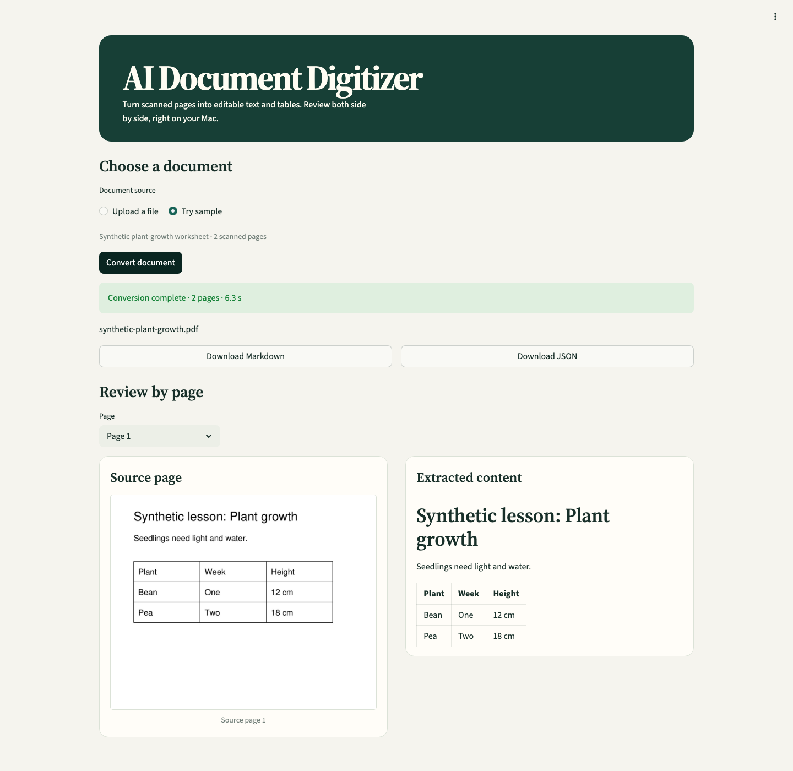

# AI Document Digitizer

Convert one educational PDF or photo on your Mac into editable Markdown and structured Docling JSON. The standard Docling pipeline uses layout analysis for reading order, preserves native PDF text, and applies OCR to bitmap regions. Table recognition produces Markdown tables and JSON cells with row and column spans where the model recognizes them.

## Why I built this

Photographed educational books are difficult to edit, search, and organize alongside digital notes. AI Document Digitizer turns those scans into Markdown for editing and structured JSON for later search or retrieval workflows. The first use case is digitizing my own learning materials on a Mac.

## What it does

- Converts one PDF, PNG, JPG, or JPEG through a CLI or a local Streamlit interface.
- Uses OCR for scanned regions and preserves native PDF text where available.
- Reconstructs recognizable tables into Markdown and structured cells.
- Keeps page and coordinate references in Docling JSON.
- Displays source pages beside extracted text and tables.
- Exports the entire document as Markdown and JSON.

## Engineering decisions

The Python pipeline owns validation, conversion, and export. Both entry points call it, so the browser interface uses the same extraction behavior as the CLI. Docling provides layout analysis and table recognition, and RapidOCR runs the English recognizer through ONNX Runtime.

Uploads use isolated temporary directories. The interface reads the exports into session memory before removing those temporary files. The CLI writes into a new result directory and reports an error when that name already exists. Export files are prepared in a staging directory before publication.

I chose local processing to make the tool usable with personal study materials. Initial model downloads need an internet connection. The verified installation processes documents offline once its weights are cached.

## Results and lessons

The automated suite passed 16 tests on the verified Mac environment. It covers supported input formats, a known synthetic table, reading order, source integrity, invalid inputs, export failures, and interface page switching. Browser checks also exercised downloads and recovery after a damaged upload.

A real 57-page scanned grammar document completed through the interface. The downloaded JSON contained 57 pages and 13 detected tables. These are processing results. OCR correctness and reconstructed cell content still need comparison with the original pages.

The synthetic example makes errors easy to inspect because its expected text and table are known. Testing it alongside a longer scan exposed different concerns, including page navigation, processing time, and loading large results. The side-by-side review screen makes those checks part of the workflow.

## Development approach

This project was developed with OpenAI Codex assistance for implementation, debugging, tests, and documentation. The project brief defines the local-first requirements and phased scope. Executed tests and browser checks are recorded here so readers can assess what was verified.

## Current limitations and roadmap

The current workflow processes one document at a time with an English OCR configuration. Reading order and table quality depend on the scan and the models. Diagrams may appear as placeholders. The UI provides a processing indicator and elapsed time.

Planned work includes batch processing with summary reports, optional preprocessing, diagram asset export, and CER/WER evaluation when labeled ground truth is available.

## Run the browser demo



From the repository root, install the optional interface dependencies and start the local server.

```sh
source .venv/bin/activate
python -m pip install -r requirements-ui.txt
python -m streamlit run app.py
```

1. Open [the local app](http://127.0.0.1:8501) and select **Try sample** or upload one PDF, JPG, JPEG, or PNG up to 150 MB.
2. Select **Convert document**. The bundled two-page plant-growth worksheet is an image-only synthetic PDF. Your first run may need internet access to download model weights. Large scanned PDFs can take several minutes.
3. Select **Page 1** to compare the original table with the extracted table. Select **Page 2** to review the observation journal. On longer documents, type a page number into the selector to jump to it. **Download Markdown** and **Download JSON** export the entire document.

The Streamlit server binds to your Mac’s loopback address. Uploads pass through the same Python pipeline as the CLI in a temporary directory, and results stay in memory for the current browser session until you switch inputs or end the session. Download exports you want to keep. Run `HF_HUB_OFFLINE=1 python -m streamlit run app.py` to use the model cache after a successful first conversion.

## Run the CLI

From the repository root, activate the environment and process one file.

```sh
source .venv/bin/activate
python main.py --input input/sample.pdf --output output
```

Replace `input/sample.pdf` with your own PDF, JPG, JPEG, or PNG. Quote paths containing spaces. A successful command writes `output/sample/content.md` and `output/sample/content.json`. A second run targeting the same result directory exits with an error. Choose another output root to keep both runs. Use `python main.py --help` for the CLI options.

Open the Markdown in an editor or Obsidian. Use the JSON to inspect the source filename, page numbers, text and table provenance, coordinates, and reading-order references. Keep the original alongside the exports for checking omissions or ordering errors. Diagrams may appear as placeholders in this version.

## Install on a fresh Mac

The verified environment uses Python 3.12.10 on Apple Silicon. From the repository root, run these commands.

```sh
python3.12 -m venv .venv
source .venv/bin/activate
python -m pip install -r requirements.txt
python -m pip check
```

The initial OCR language is English. To use a different RapidOCR recognizer, set `OCR_LANGUAGE` in `src/document_digitizer/config.py` to a language supported by RapidOCR. A language change may require downloading additional weights. The first extraction needs internet access to fetch model weights. Document processing runs locally. Remote services are disabled. Keep the model cache for subsequent runs. After the first successful conversion, prefix the command with `HF_HUB_OFFLINE=1` to use the cached Hugging Face weights. An interrupted download can be retried by rerunning the command.

## Verify the installation

```sh
python -m pytest -m 'not integration'
python -m pytest
```

The full suite generates synthetic text and scanned PDFs, PNG, JPG and JPEG samples in temporary directories. It checks text, page count, a known table, reading order, source provenance and source hashes. It also exercises invalid inputs and export failures. For a reusable sample set, choose a fresh directory:

```sh
python tests/synthetic.py input/demo
python main.py --input input/demo/synthetic-lesson.pdf --output output/demo
```

The text PDF has two pages. Its first page contains a plant-growth table. The scan contains pixels from the first page and has no selectable source text. These fixtures test the processing path. Assess OCR and layout quality on your book pages by comparing their text, columns and table cells with the exports.

## Project layout

- `main.py` parses single-file commands and reports errors.
- `app.py` provides the local upload, review, and download interface.
- `demo/` contains the synthetic browser demo sample and screenshot.
- `src/document_digitizer/` contains input checks, Docling configuration, extraction, export and the reusable pipeline.
- `tests/` contains unit tests, end-to-end tests and the synthetic fixture generator.
- `input/` and `output/` hold local documents and results. Their contents are ignored by Git.

Both entry points process one file at a time. Batch input, per-document failure handling, summary reports, and diagram asset export are on the roadmap.

The implementation follows Docling’s [custom conversion example](https://docling-project.github.io/docling/_generated/examples/custom_convert/), [converter reference](https://docling-project.github.io/docling/reference/document_converter/), and [offline model guidance](https://docling-project.github.io/docling/usage/advanced_options/).

## Dependency versions

The installed environment uses Docling 2.151.1, docling-core 2.108.0, RapidOCR 3.10.0, ONNX Runtime 1.32.0, PyTorch 2.15.0, OpenCV 5.1.0.95 (headless distribution), PyMuPDF 2.1, and pytest 9.2.0. The optional UI was verified with Streamlit 1.55.0 and Pillow 12.3.0. Use `python -m pip list` to inspect the environment after installation.

## Verification history

The final offline run passed all 14 tests in 23.12 seconds, with 20 dependency deprecation warnings. Dependency imports, `pip check`, CLI help, and direct CLI conversions of both synthetic PDFs succeeded. The sample exports in `output/synthetic-lesson/` and `output/synthetic-scan/` each contain the expected three-row, three-column table. These synthetic checks measure pipeline behavior. Real-world OCR and table accuracy require manual comparison with the source.

The Streamlit release passed all 16 automated tests offline. Browser checks covered both sample downloads, page switching, and recovery from a damaged PDF using a standalone JPG rendered from the grammar scan. The 57-page grammar PDF converted through the same browser workflow, with page 57 available for review and 13 tables recorded in the downloaded JSON.
